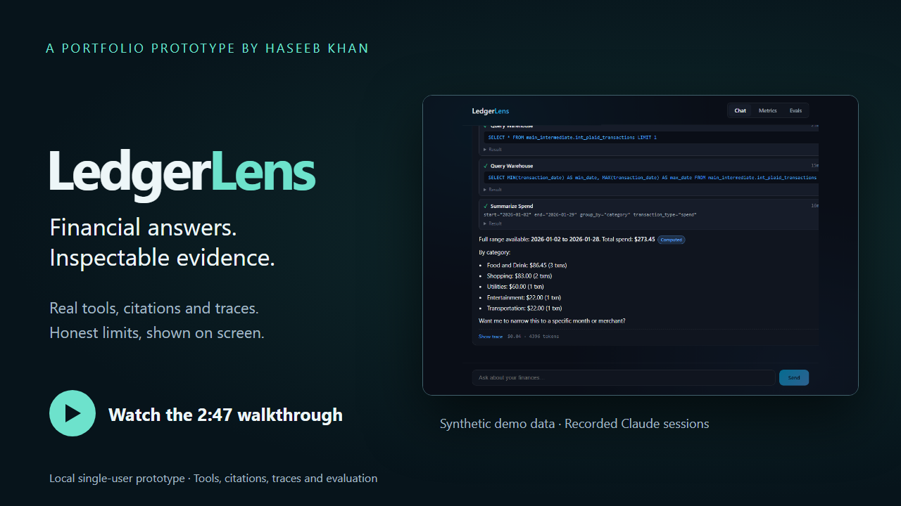
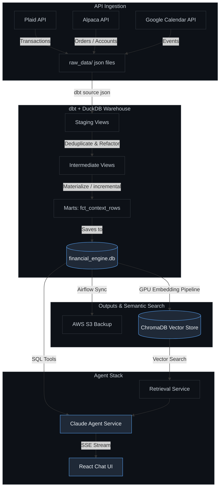

# LedgerLens — Observable AI Financial Assistant

[](https://github.com/haseebkn/financial-context-elt-pipeline/actions/workflows/ci.yml)

## Watch the 2:47 walkthrough

[](#play-the-walkthrough)

A guided tour of ingestion, cited answers, execution traces, metrics, and evaluation. The chat uses synthetic records; provider examples use Plaid Sandbox and Alpaca Paper. [Watch the video](#play-the-walkthrough).

### Play the walkthrough

https://github.com/user-attachments/assets/cc8d7947-8761-4341-998c-68d1bab9fa99

An independently built portfolio project exploring a problem relevant to wealth-management software: answering questions across financial records and calendar activity with inspectable evidence. A React/TypeScript interface connects to a Node.js Claude agent, four warehouse tools, and a Python retrieval service. Each turn exposes tool execution, citation identifiers, token usage, and latency so failures can be investigated.

The committed **August 26, 2026** Sonnet run reports **100% tool-choice accuracy, 100% retrieval recall, and 4.86/5 mean judge score across 34 cases**. Its **$0.4771 estimated agent cost excludes judge calls** and uses the pricing recorded at the time. These are historical results on a small, personal-data golden set, not a claim about production accuracy or the current audited code. Live use exposed calendar-only activity answers, unnecessary clarification, unsupported membership claims, and tool-loop exhaustion; the repository records the resulting prompt and evaluation changes.

**Start here:** [reviewer walkthrough and Verlo role mapping](docs/PORTFOLIO.md) · [audit findings and verification](docs/AUDIT.md) · [raw evaluation evidence](agent/evals/reports/2026-08-26T01-34-34-845Z.md)

The agent has been exercised locally with live model calls. It is a single-user prototype with deployment configuration; customer adoption and an operating public deployment are not claimed. This project is independent of Verlo.

---

## Run the demo

The whole stack runs on a deterministic synthetic dataset (one fictional person: six months of transactions, brokerage orders and calendar events, generated by [`scripts/seed/generate.py`](scripts/seed/generate.py)). It needs Docker and an Anthropic API key, and nothing else: no Plaid, Alpaca or Google credentials and no GPU.

```bash
ANTHROPIC_API_KEY=sk-ant-... docker compose up --build    # or: make demo
```

Open <http://localhost:8080>. The first build embeds the synthetic records on CPU, so it is slower than later ones. The data ends on 2026-11-30 so answers stay reproducible; pass `SEED_END_DATE=YYYY-MM-DD` to move it.

---

## 🚀 Key Features

*   **Tool-Using Claude Agent (`agent/`):** Answers financial questions through `search_context`, `query_warehouse`, `get_portfolio_snapshot`, and `summarize_spend`. Freeform SQL runs on a DuckDB connection that is read-only with external access disabled and its configuration locked (`lib/duckdb.ts`), so it can't read files or the network; `lib/sql-guard.ts` adds a table/function policy and row limits on top, as repair guidance for the model. Cited ids must come from this turn's tool results, and every dollar figure and record count is checked against what its sentence cites: unsupported figures are flagged "Unverified" in the UI. Percentages, dates and other prose claims are not checked.
*   **Observable execution:** The UI receives spans for LLM calls, tool execution, and citation checks. Each turn also writes a summary to `raw_data/agent_traces`; dbt ingests it into the warehouse. `/api/metrics` computes error/repair rates, cache-hit rate, cost, latency, and traffic from those persisted summaries.
*   **An eval harness that scores agents, not vibes (`agent/evals/`):** Tool-choice accuracy, retrieval recall, and an LLM-judge score (sampled n=3, spread reported rather than trusted as a point estimate) against 34 golden questions. Scorer/report logic runs in CI; the privacy-sensitive live suite runs locally against the real warehouse.
*   **React Chat Frontend (`web/`):** Streaming SSE chat with a Stop button, citation chips that open the cited row or computed result (its SQL and rows) in a side drawer, and a per-message waterfall, plus warehouse-backed Metrics and file-backed Evals.
*   **Analytical Warehouse (`transform/`):** A dbt-modeled DuckDB warehouse (staging → marts) over trades, transactions, calendar events, and the agent's own traces.
*   **Multi-Source API Ingestion (`extract/`):** Extractors for Alpaca Markets, Plaid, and Google Calendar, orchestrated by Astronomer Airflow with backup sync to AWS S3.
*   **Local GPU Vectorization (`vector_prep/`):** `sentence-transformers` embeddings generated on local GPU (CUDA), upserted incrementally to ChromaDB and served to the agent through an internal retrieval service.
*   **Containerized serving path (`infra/aws/`):** Dockerfiles for all three services and a Terraform stack (ECS Fargate, ALB, EFS, Secrets Manager). Public access control, TLS, spend limits, and a reviewed demo dataset are still deployment prerequisites.

---

## 🗺️ System Architecture



---

## 📂 Project Structure

```text
financial-context-elt-pipeline/
├── config/
│   └── pipeline_config.yaml    # Global parameters & extractor query configurations
├── extract/
│   ├── base_client.py          # Resilient API client with pagination & retries
│   ├── alpaca_extractor.py     # Alpaca orders/accounts extraction
│   ├── plaid_extractor.py      # Plaid sandbox transactions extraction
│   ├── google_calendar_extractor.py # OAuth2 Google Calendar events extraction
│   └── run_extraction.py       # Main ingestion runner
├── load/
│   └── file_writer.py          # Ingestion landing zone JSON writer
├── orchestration/              # Astronomer Airflow project configuration
│   ├── dags/
│   │   └── financial_context_dag.py # Complete pipeline orchestration DAG
│   └── Dockerfile              # Astronomer Airflow docker image overrides
├── raw_data/                   # Local landing directory for raw extraction payloads (Git ignored)
├── transform/                  # dbt models project
│   ├── models/                 # staging, intermediate, and marts sql models
│   ├── profiles.yml            # dbt configurations for DuckDB target
│   └── dbt_project.yml         # dbt settings, materialization types, and source variables
├── vector_prep/                 # Semantic search integration
│   ├── app.py                   # FastAPI stats/search API (no UI — see web/ for the frontend)
│   ├── retrieval_service.py     # Internal retrieval service used by the agent
│   ├── embed_context.py         # CUDA hardware checker, embed generator & ChromaDB loader
│   ├── vector_client.py         # Local ChromaDB connection client wrapper
│   └── verify_embeddings.py     # Command-line query verification script
├── agent/                       # Node/TypeScript Claude agent service (see agent/README.md)
├── web/                         # React chat frontend for the agent (Chat / Metrics / Evals)
├── requirements.txt             # Python environments & packages list
└── financial_engine.db          # Compiled DuckDB warehouse file (generated)
```

---

## 🛠️ Setup & Installation

### Prerequisites
*   **Node.js:** `22.12` or later in the Node 22 release line (or a compatible newer version).
*   **Python:** `3.11` matches CI and the pinned embedding dependencies.
*   **GPU Drivers:** CUDA is optional; embedding generation also supports CPU. `requirements.txt` installs the default PyTorch build; `requirements-gpu.txt` adds the CUDA 12.1 build.
*   **Docker:** Required for running the local Airflow/Astronomer orchestration.

### Step 1: Clone the Repository
```bash
git clone https://github.com/haseebkn/financial-context-elt-pipeline.git
cd financial-context-elt-pipeline
```

### Step 2: Create a Virtual Environment & Install Dependencies
```bash
python -m venv venv
# On Windows:
.\venv\Scripts\activate
# On Linux/macOS:
source venv/bin/activate

# Install core dependencies (use requirements-gpu.txt instead for CUDA PyTorch)
pip install -r requirements.txt
```

### Step 3: Configure Environment Secrets (`.env`)
Create a `.env` file in the project root directory and populate it with your credentials:

```ini
# General Configuration
ENVIRONMENT=development
LOG_LEVEL=INFO
RAW_DATA_DIR=./raw_data

# Alpaca Markets API Credentials (Paper/Sandbox)
ALPACA_API_KEY_ID=your_alpaca_key
ALPACA_API_SECRET_KEY=your_alpaca_secret
ALPACA_IS_PAPER=True

# Plaid API Credentials (Sandbox)
PLAID_CLIENT_ID=your_plaid_client_id
PLAID_SECRET=your_plaid_secret
PLAID_ENVIRONMENT=sandbox
PLAID_ACCESS_TOKEN=your_plaid_access_token

# Google Calendar API Credentials
# (Ensure credentials.json is placed in the root directory for initial login auth flow)
GOOGLE_APPLICATION_CREDENTIALS=./credentials.json
GOOGLE_TOKEN_PATH=./token.json
GOOGLE_CALENDAR_ID=primary

# AWS S3 Cloud Integration (State backup)
AWS_ACCESS_KEY_ID=your_aws_access_key
AWS_SECRET_ACCESS_KEY=your_aws_secret_key
AWS_DEFAULT_REGION=us-east-1
AWS_S3_BUCKET=your_s3_bucket_name
```

---

## ⚙️ How to Run the Pipeline (Manual Mode)

You can run individual components of the pipeline manually directly from your terminal:

### 1. Ingest Data
Executes extraction pipelines for Calendar, Alpaca, and Plaid APIs, storing raw JSON files inside `raw_data/`:
```bash
python extract/run_extraction.py
```

### 2. Run dbt Transformations
Builds the DuckDB warehouse, compiling raw JSON views into staging, intermediate, and marts tables (`financial_engine.db`):
```bash
cd transform
dbt build
cd ..
```

### 3. Compute Embeddings & Load to Vector Store
Processes data from the analytical dbt models, generates PyTorch embeddings on your GPU, and stores them in ChromaDB:
```bash
python vector_prep/embed_context.py
```

### 4. Query & Verify Embeddings
Run a sample semantic search query via CLI to verify database contents:
```bash
python vector_prep/verify_embeddings.py
```

### 5. Launch the Agent + Chat Frontend
Three services make up the agent stack: the retrieval service (semantic search over ChromaDB), the agent service (the Claude tool-using loop + REST/SSE API), and the React chat UI.

Run `npm ci` once from the repository root. Copy `agent/.env.example` to `agent/.env`, set `ANTHROPIC_API_KEY`, and set the same `RETRIEVAL_SERVICE_TOKEN` in both that file and the root `.env`. The root pipeline `.env` alone does not configure the Node agent.

```bash
# Terminal 1 — retrieval service
uvicorn vector_prep.retrieval_service:app --host 127.0.0.1 --port 8100

# Terminal 2 — agent service
npm run dev:agent

# Terminal 3 — web frontend
npm run dev:web
```

Open [http://localhost:5173](http://localhost:5173) for the chat UI — it proxies `/api/*` to the agent service and includes Chat, Metrics, and Evals tabs.

### Verified evaluation evidence

The committed August 26 Sonnet baseline is rendered directly by the Evals tab. The audit corrected measurement labels while retaining the original reports:

| Metric | Sonnet 5, 34 cases |
|---|---:|
| Tool-choice accuracy | 100% |
| Retrieval recall | 100% |
| Mean LLM-judge score | 4.86 / 5 |
| Judge spread (mean / max) | 0.12 / 1.00 |
| Historical p50 / p95 case duration (agent + judge) | 11.7s / 24.3s |
| Historical estimated agent cost (judge excluded) | $0.4771 |


This screenshot predates the audit; the current UI labels agent cost and legacy case duration explicitly. New runs measure agent latency separately. A fresh paid evaluation is needed before attributing quality improvements to the audit fixes.

The raw report is committed under [`agent/evals/reports/`](agent/evals/reports/). One raw judge false negative is retained and manually adjudicated rather than silently edited out: the judge called a real `$2,078.50` Payment row fabricated and demanded both sides of an explicitly either/or rubric. After clarifying the contract, a targeted n=3 rerun scored that case 5/5 with zero spread. This is why the harness reports judge spread and keeps human adjudication visible.

The Metrics tab is populated from persisted turn summaries after a dbt refresh. It exposes iteration count, observed error/repair rates, prompt-cache hit rate, model cost, latency percentiles, tool distribution, and traffic by day:


See [`agent/README.md`](agent/README.md) for the agent's architecture, tool descriptions, and setup, and [`web/README.md`](web/README.md) for the frontend.

`vector_prep/app.py` also exposes a plain `/api/stats` and `/api/search` for ad hoc semantic queries against ChromaDB, independent of the agent stack:
```bash
uvicorn vector_prep.app:app --host 0.0.0.0 --port 8000 --reload
```

---

## 🔄 Pipeline Orchestration (Astronomer Airflow)

If you prefer to run the entire pipeline automatically on a scheduled, orchestrated frequency, use Astronomer:

1.  **Navigate to the orchestration directory:**
    ```bash
    cd orchestration
    ```
2.  **Start Airflow dev containers:**
    ```bash
    astro dev start
    ```
3.  **Access Airflow Dashboard:**
    Open [http://localhost:8080](http://localhost:8080) and log in using user `admin` and password `admin`.
4.  **Execute the DAG:**
    Trigger the `financial_communication_context_engine` DAG. It will automatically run the ingestion script, build dbt models, and synchronize `financial_engine.db` with your AWS S3 bucket.

---

## ☁️ AWS Deployment

LedgerLens deploys on AWS's **Always-Free Serverless** tier (~$0/month even on older AWS accounts with no free-tier credits) via Terraform under [`infra/aws/`](infra/aws): **CloudFront** (free `https://<id>.cloudfront.net` HTTPS URL + security headers), **S3** (static React SPA + SHA-tagged release zips), **AWS Lambda** (Node.js 22 with `RESPONSE_STREAM` Function URL for live SSE streaming, read-only baked DuckDB warehouse, and in-process `RETRIEVAL_MODE=local` search), **Cognito** ("Try the demo" JWT sign-in), and **SSM Parameter Store** (Standard SecureStrings outside Terraform state).

```bash
cd infra/aws/bootstrap && terraform init && terraform apply
cd ..
cp backend.hcl.example backend.hcl            # fill in state_bucket
cp terraform.tfvars.example terraform.tfvars  # no secrets — domain_name optional
terraform init -backend-config=backend.hcl
terraform apply
```

See [`infra/aws/README.md`](infra/aws/README.md) for the architecture diagram, Always-Free cost breakdown, SSM secret setup, and [`.github/workflows/deploy.yml`](.github/workflows/deploy.yml) for SHA-tagged deploys with automatic Lambda alias rollback and post-deploy smoke testing.

---

## 🧭 Engineering notes

A few decisions worth being explicit about, in case they read as gaps rather than choices:

*   **The Anthropic path has been exercised end to end.** The live agent completed dozens of real tool-using turns against the populated warehouse, followed by multiple 34-case Opus and Sonnet runs. That exposed behavior unit tests could not: calendar-only activity conclusions, clarification loops on unspecified totals, aggregate claims cited with sample rows, membership claims inferred from recurring billing, and a tool loop that consumed every iteration without returning prose.
*   **CI doesn't fake coverage it doesn't have.** Where fixture data doesn't match production data shape closely enough to make a green check mean something, the gap is documented rather than wired into a misleading gate.
*   **The AWS stack is a deployment exercise, not the proposed $5/month host.** Its three always-running tasks, load balancer, and public IPv4 addresses incur idle charges. It needs TLS, access control, and reviewed demo data before public use. See `infra/aws/README.md` for the deployment boundary.
*   **Two real bugs were caught by testing against real state instead of trusting the first green run:** an incremental dbt model using the wrong watermark column, and a `view`-materialized model whose `read_json_auto()` path resolved against the caller's working directory instead of build time — both invisible until something queried the model from a different directory than the one it was built from.

### Building with coding agents

This repository was developed with Claude Code and Codex as active engineering tools, not as one-shot code generators. The useful workflow was: ask the agent to implement a bounded slice, run the result against real state, preserve the exact failure, then turn that failure into a test and a narrowly named commit. The strongest work in the repository came from the feedback loop, not the first generated patch.

Three examples changed how I use coding agents:

*   A NumPy/ChromaDB incompatibility looked like an application bug until the environment was reproduced cleanly; dependency resolution had to be treated as part of the product, not setup trivia.
*   npm workspace hoisting made a package appear healthy locally while its documented command failed from the package directory; running the exact README commands exposed the difference.
*   A dbt model materialized as a view resolved `read_json_auto()` relative to the later query process, not the original build. The generated SQL compiled, but only real execution from another working directory revealed the bug.

The practical view I would carry into a team is that AI reduces the cost of producing and exploring implementations, but increases the importance of executable contracts: real-state tests, traceable failures, small commits, and evals that distinguish model behavior from scorer behavior.
